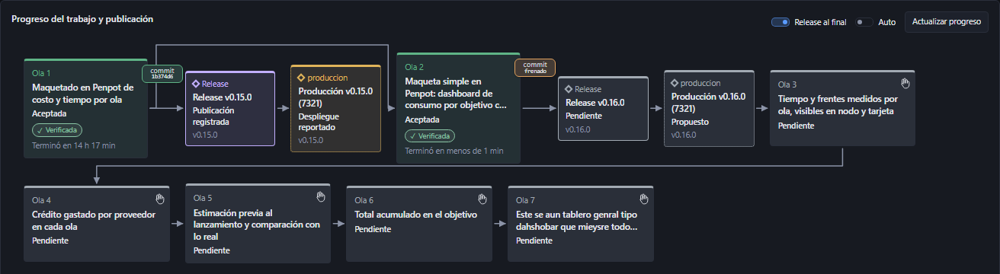
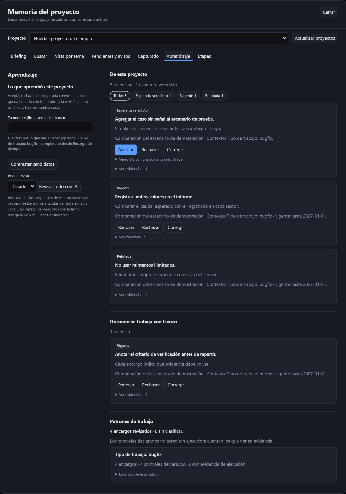
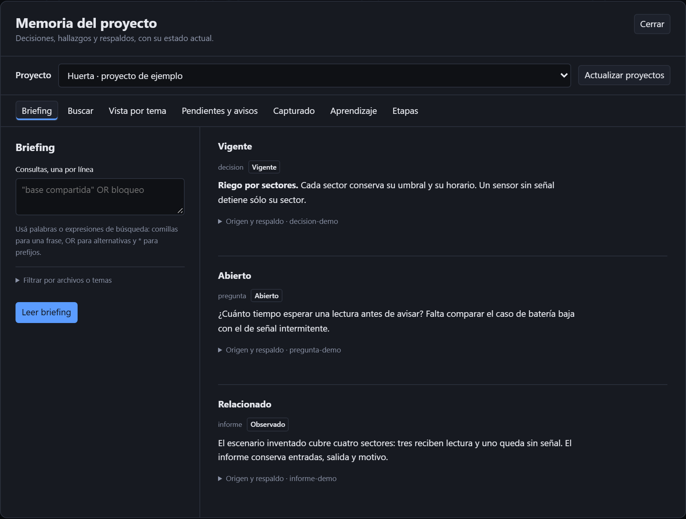
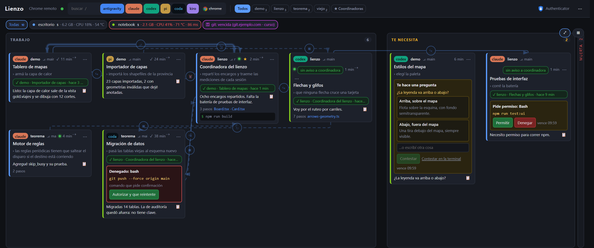

  

# Lienzo

  
  
  
  
  
  
  

**Una fábrica de software con agentes.**

Convertí un objetivo en trabajo coordinado entre Claude Code, Codex, coda y otros agentes.
Una coordinadora reparte los encargos, recibe los informes y verifica lo producido.
Vos seguís el trabajo desde un tablero e intervenís cuando hace falta.

Las sesiones pueden correr en una PC o repartirse entre hasta 4 PCs emparejadas de la misma LAN.
El método conecta construcción, revisión y aprendizaje: cada ronda deja decisiones y evidencia
que sirven para la siguiente.

**Versión 0.16.0.**

## Una fábrica de software

<picture>
  <source media="(prefers-color-scheme: dark)" srcset="assets/fabrica-dark.svg">
  
</picture>

La cinta representa el trabajo que circula. La torre es la coordinadora y sus cajones conservan
las rondas. Los útiles distintos representan frentes con un resultado y archivos a cargo;
las fichas ámbar son encargos y las verdes, informes que vuelven. El pórtico es el meta-harness
que lanza, observa y conecta los agentes. Los tres útiles son ilustrativos: no representan
pasos obligatorios ni un máximo de sesiones.

Desde una tarjeta podés leer la conversación, mandar mensajes, adjuntar capturas y responder
permisos. También podés lanzar sesiones, conectar sus informes, copiar archivos y manejar el
Chrome de otra PC. Cada PC sigue siendo dueña de sus procesos, sus permisos y sus recursos.

Corre en `127.0.0.1:7321`. Lee el historial de cada agente y escribe en su terminal.
Las terminales y las transcripciones siguen a cargo de los agentes.

## Factory: objetivos, olas y frentes

Factory es donde Lienzo ejecuta la coordinación sola. Se organiza como **Proyecto → Objetivo → Ola**: un objetivo
es lo que querés lograr y se entrega en olas cortas, cada una con uno o varios frentes en paralelo.

- **Del texto a las olas.** Pegás el pedido; la IA lo corrige, lo enriquece y propone las olas. Le podés dar
  instrucciones («separalo en tres objetivos») e iterar la propuesta en un chat antes de aceptarla.
- **Con play, Factory trabaja.** Redacta el encargo de cada ola, lo reparte entre agentes (Claude Code, Kiro y
  otros), observa la entrega, la verifica con evidencia y, al aceptarla, commitea. Con «Release al final» publica la
  versión y registra el pasaje a producción.
- **Cuando algo falla.** «Reintentar» elige la acción segura (relanzar con un agente nuevo, reverificar o acreditar la
  entrega hecha por otro frente) y dice qué hizo.
- **Decidís vos.** Aceptar cada ola y cerrar el objetivo son decisiones explícitas; las preguntas llegan a una sola
  bandeja.

## La coordinación como metodología

Una ronda parte de un objetivo y lo divide en encargos verificables. La coordinadora sostiene
el contexto común y cada frente trabaja sobre su parte. El método se puede seguir desde los
propios agentes con el skill de Lienzo.

1. **Preparar.** Leer el estado del proyecto y los aprendizajes aplicables. Definir el resultado,
   el alcance y la evidencia que permitiría aceptarlo. Lienzo trabaja con
   [FDD](https://github.com/arielelevy/fdd), con documentación proporcional al trabajo.
2. **Repartir.** Escribir un encargo por frente: carpeta, insumos, archivos propios, restricciones
   y criterio de verificación. Los frentes de un mismo árbol no se pisan ni commitean por su cuenta.
3. **Coordinar.** Conectar cada frente con la coordinadora y el informe de vuelta. Las rondas
   largas usan avisos con acuse y turnos para recursos pesados. Los frentes no se contestan
   entre sí indefinidamente: la coordinadora decide el próximo paso.
4. **Verificar.** Leer el informe y contrastarlo contra el árbol: cambios reales, pruebas,
   revisión y pendientes. Que una sesión termine o diga «listo» no acredita el resultado.
5. **Dar veredicto.** Registrar qué se sostiene, qué se devuelve y qué sigue abierto, con evidencia
   y motivo. Integrar o cerrar requiere la decisión que corresponda; recibir un informe no la sustituye.

Rondas, encargos, informes y veredictos quedan vinculados en la memoria del proyecto. Así, la
ronda siguiente puede recuperar tanto una decisión como las razones y pruebas que la sostienen.

## El meta-harness

El harness de cada agente administra su conversación, herramientas y ejecución. Lienzo envuelve
esos harness con una capa común de coordinación. Claude Code, Codex y coda conservan su identidad
y sus capacidades; la cobertura depende de la integración de cada uno.

| Capa de Lienzo | Qué aporta al trabajo |
|---|---|
| Lanzamiento y continuidad | Elegir agente y PC, titular, retomar sesiones y conservar conexiones cuando hay una sucesora identificada. |
| Hooks y permisos | Observar estados, llevar pedidos al tablero y devolver decisiones al agente. |
| Cuotas y recursos | Consultar margen de uso, memoria y disponibilidad antes de abrir más frentes o investigar en segundo plano. |
| Mejoras de agentes | Aplicar las integraciones habilitadas al lanzar y mostrar su disponibilidad, costo y límites. |
| Contexto y controles | Llevar aprendizajes vigentes a las sesiones y frenar patrones concretos de comandos cuando hay un control activo. |

Al arrancar el servidor, Lienzo comprueba y aplica las actualizaciones de los harness instalados
(Claude Code, Codex, Pi, CODA y Kiro), usando sus comandos propios. Repite la comprobación cada
6 horas. Antes de iniciar o retomar una sesión, comprueba ese harness si venció el intervalo y
espera hasta 120 segundos. Un error queda en el log y como aviso del lanzamiento; la sesión puede
abrirse igual y la comprobación se reintenta tras 15 minutos. Las instalaciones de WSL se comprueban
al lanzar en esa distro y luego periódicamente. Las sesiones abiertas conservan su proceso original.

El detalle de mejoras, automatizaciones e
integraciones con límites queda en la referencia operativa.

## IA, Prolog y aprendizaje continuo

<picture>
  <source media="(prefers-color-scheme: dark)" srcset="assets/aprendizaje-continuo-dark.svg">
  
</picture>

Los filtros separan lo registrado de lo interpretado. El cabezal Prolog representa el contraste
lógico; la llave aparte, el veredicto humano. Las hojas retiradas vuelven al contexto, checklist
y controles de la ronda siguiente. Las capas **1 → 2 → 3 → creencias** describen niveles de
lectura: no obligan a convertir cada captura por todos ellos.

| Nivel | Qué conserva y quién lo usa |
|---|---|
| **1 · Crudo** | Pedidos, respuestas y eventos capturados, con su procedencia. Permite volver a la fuente mientras se conserve; las transcripciones originales siguen en cada agente. |
| **2 · Cómo se hizo** | Actividad, tiempos, esperas y quién hizo qué. El investigador usa vistas acotadas y redactadas del proceso; no supone un registro exhaustivo de cada herramienta. |
| **3 · Qué se hizo** | Resultados, temas, decisiones, hallazgos y preguntas. Sirve para recuperar contexto y para consumidores externos, sin exponerles el crudo. |
| **4 · Creencias propuestas** | El investigador con IA propone cómo mejorar el trabajo, con fuentes, alcance, excepciones y límites. Una propuesta todavía no es una regla vigente. |

El resumidor trabaja en segundo plano sobre días cerrados de pedidos y
respuestas. Produce informes `resumen_nivel3`, conserva un cursor y declara los recortes de su
muestra. La depuración del crudo espera también ese cursor. El
investigador de creencias lee novedades de memoria, evidencias,
reviews, coordinación y pruebas; distingue mejoras propias del proyecto de mejoras del proceso
de trabajar con Lienzo. También puede proponer formalizaciones de creencias existentes.

**La IA propone; Prolog hace explícitas las consecuencias de hechos y reglas formalizadas.**
El ciclo lógico tiene tres trabajos:

- **Contraste:** detectar apoyos caídos, contradicciones y premisas que dejaron de sostenerse.
- **Contraejemplos:** poner a prueba una generalización contra casos y condiciones registrados.
  No encontrar uno en esa muestra no demuestra una ley universal.
- **Deducción:** encadenar reglas formalizadas habilitadas para obtener conclusiones nuevas,
  conservando la prueba y sus premisas. Una creencia escrita sólo en prosa no alcanza para ese encadenamiento.

El motor separado requiere SWI-Prolog y `motor-logico`. Lienzo verifica sus pruebas y contrasta
con cálculos Python independientes donde corresponde. Un fallo o falta de contraste se informa;
no se presenta como respaldo. Las creencias y derivaciones requieren veredicto humano con
evidencia para adquirir vigencia. Si cae una premisa, la conclusión queda sujeta a revisión.

Lo aprendido vuelve por tres caminos:

- **Contexto de sesión.** contexto_sesion.py proyecta principios de
  proceso y creencias vigentes del proyecto. Claude los recibe por `SessionStart`; los otros
  agentes que lanza Lienzo, por las instrucciones del lanzamiento.
- **Checklist del encargo.** La coordinadora consulta creencias aplicables y las incorpora al
  reparto. El checklist distingue lo sostenido, lo cuestionado y lo que no tiene contraste del motor.
- **Controles de comandos.** En Claude, `PreToolUse` de Bash aplica controles del catálogo
  activados por una creencia vigente. Hoy incluye frenar pruebas enviadas por pipe a comandos
  como `tail` o `tee` sin `pipefail`, porque podrían ocultar el código de salida de una falla.

El uso posterior también deja evidencia: si una creencia sirvió, no aplicó o ya era conocida.
Ese retorno permite revisar el aprendizaje. El bot externo expone sólo
lecturas de nivel 3, con clave y selección de proyectos; usa un servidor separado del que controla
sesiones. El diseño y sus límites están en Producto,
Aprendizaje y el contrato de memoria.

 

[Arquitectura, diseño y recorridos de los pedidos](https://arquitectura-lienzo.ariel-e-levy.chatgpt.site/)

## Documentación pública

Este repositorio contiene documentación y recursos visuales. Descargarlo no instala Lienzo. Para consultar por acceso a la aplicación o una demostración, contactá a [Ariel Levy](https://github.com/arielelevy).

- [Copiar archivos entre PCs](docs/copias-entre-pcs.md)

## Licencia

Software, documentación y recursos visuales propios: **licencia propietaria, todos los derechos
reservados**. Su publicación no autoriza el uso, la modificación ni la redistribución.
Consultá [LICENSE](LICENSE) para las condiciones y el contacto. Los componentes y materiales
de terceros conservan sus licencias.
